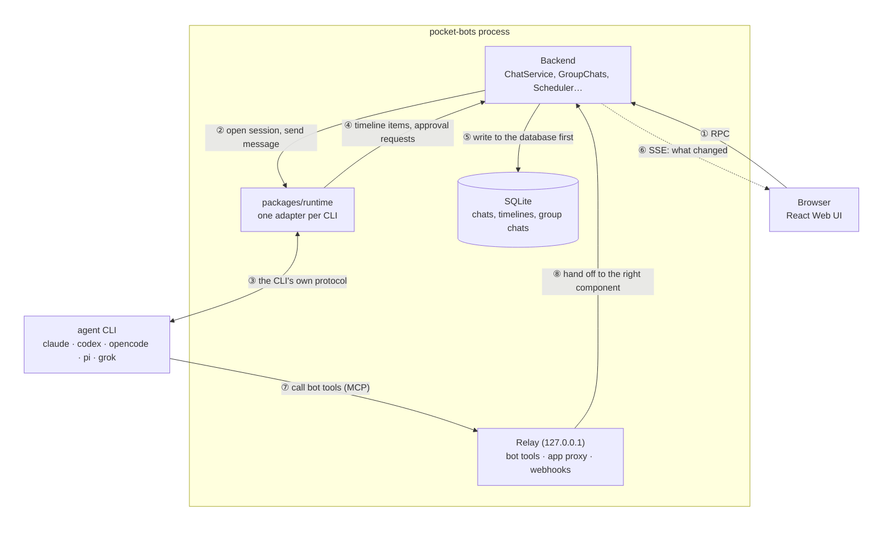

# Pocket Bots

English | [简体中文](README.zh-CN.md)

Personal bots that run on your own computer. Each bot has its own instructions, model, long-term memory, skills, MCP tools and connected apps. You can chat with it, have it work on its own on a schedule or when a webhook arrives, and put several bots into one group chat to split up the work.

pocket-bots drives the CLIs of five coding agents directly: **Claude Code, Codex, OpenCode, Pi and Grok Build**. Each CLI uses **the account and subscription you already logged in with**; pocket-bots never stores or injects any API key.

The docs below are written in Chinese:

- What it can do: [docs/features.md](docs/features.md)
- How to use each feature: **[usage guide](docs/USAGE.md)**
- How it is built (components, communication, agents, bots, group chats): [docs/design.md](docs/design.md)
- How several bots work together in a group chat (full rules and examples): [docs/group-chats.md](docs/group-chats.md)
- The group chat protocol (for developers: how messages flow, what each step reads and writes, who receives what in each combination): [docs/group-protocol.md](docs/group-protocol.md)

> **About Claude**: Claude is driven through the Claude Agent SDK, using the `claude` installed on your machine and your own claude.ai login. Anthropic does not allow third-party products to offer claude.ai login to other people, so this part is for your personal use only.

## Goals and status

What pocket-bots aims to become:

- **Runs anywhere**: on your machine, your own server or in the cloud, and a bot can move between them without being set up again.
- **Managed from your phone**: chat with bots, answer approvals and see what they are doing from a phone.
- **Talks to other bots**: not only between pocket-bots' own bots, but also exchanging messages and working with outside bots (such as grok-bot or Muse bot).
- **Several agents behind one bot**: Claude Code, Codex, Pi, OpenCode, Grok Build, DeepSeek harness… pick the best one for each task and combine the strengths of each harness.
- **Fewer dependencies, native multi-agent support**: talk to each agent directly over its own native protocol instead of going through third-party SDKs and wrapper layers, so adding or upgrading an agent pulls in as little as possible.
- **Interruptible and resumable**: all runtime state is persisted, so the process can be killed or the machine restarted at any time and work picks up where it left off.

Where it is today:

| Goal | Today |
|---|---|
| Where it runs | Only on your own machine. The Web UI has no login, so putting it on a server or in the cloud needs your own auth layer |
| Phone control | No dedicated mobile app; you can open the Web UI in a phone browser over a trusted network (such as Tailscale) |
| Talking to other bots | Only between pocket-bots' own bots: `ask_bot` and group chats |
| Supported agents | Five: Claude Code, Codex, OpenCode, Pi, Grok Build; DeepSeek harness is not connected yet |
| Dependencies | Codex, Pi and Grok Build are driven directly over their own protocols (JSON-RPC, RPC, ACP); Claude Code still goes through the Claude Agent SDK and OpenCode through `@opencode/client` |
| Combining agents | Each bot picks one agent; in a group chat, bots on different agents can split the work |
| Persistence | Chats, timelines and group messages are written to SQLite before they are shown; after a restart, sessions resume from their saved session ids. A turn that was running when interrupted is not re-run automatically |

## Terms

Words this README and the docs use often:

| Term | Meaning |
|---|---|
| **Agent CLI** | A coding agent's command-line program installed on your machine: `claude`, `codex`, `opencode`, `pi`, `grok`. pocket-bots starts it as a child process and uses it as the bot's "brain" |
| **Harness** | The layer around a model that runs the agent loop: the prompt, the tools, approvals and context management. Each agent CLI is one harness |
| **Session / turn** | A session is one ongoing conversation with an agent CLI and has an id it can be resumed from. A turn is one round inside it: you send a message, the agent works (possibly calling many tools) until it replies |
| **Steer** | Sending a new message into a turn that is still running, so the agent sees it right away instead of after the turn ends |
| **Interrupt / resume** | Interrupt stops the running turn. Resume reopens a closed session from its saved id, keeping the earlier conversation |
| **Approval** | The agent asks before an action such as running a command or editing a file. pocket-bots answers: it allows some automatically and shows a card in the chat for the rest |
| **Timeline item** | One entry in a chat as pocket-bots stores and shows it: a user message, a reply, thinking, or a tool call with its details. All five CLIs' output is turned into this one format |
| **MCP** | [Model Context Protocol](https://modelcontextprotocol.io): a standard way to give an agent extra tools. A bot's MCP servers, connected apps and pocket-bots' own tools all reach the agent through MCP |
| **Relay** | A small HTTP server inside pocket-bots that listens only on 127.0.0.1 (port 6881 by default). Agents call pocket-bots' tools through it, and other local programs trigger webhooks on it |
| **RPC** | Remote procedure call: calling a function that runs in another process. Here, every browser action is a `POST /api/rpc/<name>` to the backend |
| **JSON-RPC / ACP** | Protocols that some CLIs speak over stdin/stdout. JSON-RPC is a generic request/response format in JSON (used by Codex and Pi); ACP, the [Agent Client Protocol](https://agentclientprotocol.com), is a JSON-RPC protocol made for driving coding agents (used by Grok Build) |
| **SSE** | Server-Sent Events: a long-lived HTTP response through which the server keeps pushing short messages to the browser. pocket-bots uses it (`GET /api/events`) to tell the page "something changed" so it reloads that part |
| **Routine** | A task a bot runs on its own, on a schedule or when a webhook arrives. Each run opens a new chat |
| **Webhook** | A URL that another program POSTs to in order to start a routine |
| **Seat** | A bot's place in a group chat. It is an ordinary chat between pocket-bots and that bot; the bot reads and writes the group through group chat tools |
| **Composio** | A third-party service that connects apps such as Gmail and Slack. pocket-bots uses your Composio key to give bots access to those apps |
| **Contract test** | One shared test suite that every agent adapter must pass (tools, approvals, steering, interrupting, resuming), so the five CLIs behave the same to the rest of pocket-bots |

## The five agents

| Agent | How it is driven | Steering into a running turn | Bot tools | Approvals |
|---|---|---|---|---|
| Claude Code | Claude Agent SDK (local `claude`) | ✅ after the current tool call finishes | HTTP MCP (`bots`) | `canUseTool` |
| Codex | `codex app-server` (JSON-RPC) | ✅ `turn/steer` | Dynamic tools (skip MCP approval) | server request |
| OpenCode | `opencode serve` + `@opencode/client` v2 | ✅ `delivery: "steer"` | HTTP MCP (one server per session) | permission rules + `permission.asked` |
| Pi | `pi --mode rpc` + pocket-bots' extension | ✅ RPC `steer` | MCP registered by the extension (Pi ≥ 1.0) | the extension's `tool_call` hook |
| Grok Build | ACP: `grok agent stdio` | ✅ `_x.ai/interject` | ACP MCP servers | `session/request_permission` |

pocket-bots answers every approval itself: the bot's own tools need no approval, and everything else shows a card according to the bot's approval mode. Every agent passes the same contract test (calling tools, approvals, a steered message being accepted and acted on, interrupting, resuming in a new process); see `packages/runtime/test/contract.ts`.

## Install

You need:

1. **Node.js 24 or newer** (it uses the built-in `node:sqlite`).
2. **At least one logged-in agent CLI.** For example, run `claude` once in a terminal and log in; for the others: `codex login`, `grok` (log in to grok.com), `opencode`, `pi` (`/login`).

Then:

```bash
git clone https://github.com/hustnn/pocket-bots.git
cd pocket-bots
npm install
npm run build          # build the Web UI
```

## Start

```bash
npm start
```

Open <http://127.0.0.1:6880>. The top left lists the agents that are ready. Click **New bot** to create your first bot; see the [usage guide](docs/USAGE.md).

The backend has to stay running: chat sessions, group chat delivery, daily journals, memory change logs, scheduled routines, webhooks and queued messages all depend on it. For long-term use, install it as a service that starts when you log in (launchd on macOS, systemd on Linux):

```bash
npm run service -- install     # also status, uninstall, print
```

See the [usage guide](docs/USAGE.md#1-准备工作).

## Configuration

The data directory defaults to `~/.pocket-bots` and can be changed with the `POCKET_BOTS_HOME` environment variable. It holds `bots.json` (bots and the library), `pocket-bots.sqlite` (chats, timelines, group chats) and `Bots/<botId>/` (each bot's working directory, memory and skills). You can add a `config.json`:

```json
{
  "web": { "host": "127.0.0.1", "port": 6880, "hostnames": [] },
  "relay": { "port": 6881 }
}
```

| Setting | Environment variable | Default | Meaning |
|---|---|---|---|
| `web.host` | `POCKET_BOTS_HOST` | `127.0.0.1` | Address the Web UI listens on |
| `web.port` | `POCKET_BOTS_PORT` | `6880` | Web UI port |
| `web.hostnames` | `POCKET_BOTS_HOSTNAMES` (comma-separated) | `[]` | Extra hostnames to allow (protection against DNS rebinding) |
| `relay.port` | `POCKET_BOTS_RELAY_PORT` | `6881` the first time, then kept | Local port for bot tools, the app proxy and webhooks |

- **Only one pocket-bots can run per data directory.** To run two at once, give the second its own `POCKET_BOTS_HOME`.
- **The Web UI has no login.** It listens only on `127.0.0.1` by default. To reach it from other devices, open it only on a trusted network (such as Tailscale) or put it behind a reverse proxy with authentication.

## How it works

pocket-bots is one Node process on your computer that sits between the browser and the agent CLIs: you act on the page, it drives the CLIs to do the work, then stores the CLIs' output for you to see. Each arrow in the diagram is numbered and explained below.



The boxes:

- **Backend**: where the product logic lives: bots, chats, group chats, scheduled routines, memory.
- **packages/runtime**: only drives one agent session (open, send, steer, interrupt, approve, resume) and knows nothing about bots or groups.
- **SQLite**: `pocket-bots.sqlite` in the data directory. Bot configuration is not here but in `bots.json`.
- **Relay**: an HTTP server listening only on 127.0.0.1 (port 6881 by default) that lets agents call back into pocket-bots.
- **agent CLI**: a CLI installed and logged in on your machine, running outside the pocket-bots process with its own account.

When you send a message (①–⑥):

- **① Browser → backend**: every action on the page is one RPC (`POST /api/rpc/<name>`), whether sending a message or clicking an approval card.
- **② Backend → runtime**: the backend opens this chat's session with the bot's current configuration (system prompt, memory, tools); a chat that was opened before resumes from its saved session id. A session closes after 15 idle minutes and resumes on the next message, and each open picks up the bot's latest configuration; however, Claude Code and Codex ignore a new system prompt on resume and keep the one the session started with.
- **③ Runtime ↔ CLI**: each adapter sends messages and receives output using that CLI's own protocol; see the "five agents" table above.
- **④ Runtime → backend**: the output of all five CLIs is turned into the same kind of timeline item: user messages, replies, thinking, tool calls and their details. When a CLI asks for approval, tools that need none (pocket-bots' own read, proposal and group chat tools, and MCP tools you ticked under **Access**) are allowed right in the adapter; the rest go to the backend: anything matching the command allowlist or a trusted folder is allowed, and the remainder shows a card in the chat, whose answer comes back through ①. Which actions need approval is decided by the CLI's own approval mode; pocket-bots only decides how to answer.
- **⑤ Backend → SQLite**: every item is written to SQLite before the page is notified. The process can be killed at any time, and everything you saw is still there after a restart.
- **⑥ Backend → browser**: SSE (Server-Sent Events, a connection the server keeps open to push messages; see [Terms](#terms)) only tells the page "what changed" without carrying data (hence the dashed line); the page then fetches the new content through ①.

When an agent calls back into pocket-bots (⑦–⑧):

- **⑦ CLI → relay**: when the agent calls pocket-bots' own tools (`ask_bot`, group chat tools, proposal cards…) or connected apps (Gmail, Slack…), it connects to the relay over MCP. Each chat's MCP configuration carries a token that tells the relay which chat of which bot is calling. Codex is the exception: its adapter forwards pocket-bots' own tools to the relay on its behalf.
- **⑧ Relay → backend**: pocket-bots' own tools are handed to the matching component, for example `group_send` goes to group chats. Connected apps do not go through the backend: once the relay checks that this bot may use the app, it adds your Composio key and forwards the call.

The webhooks in the Relay box are not called by agents: another program POSTs to `http://127.0.0.1:<relay port>/hooks/<routineId>/<secret>`, and the backend opens a new chat to run that routine, following the same flow from ②. The relay listens only on 127.0.0.1, so the caller must be on the same computer.

Group chats use the same channels. Each bot has a **seat** in the group, which is an ordinary chat going through ②–⑥. A bot can read and write the group only through group chat tools (⑦⑧); text it outputs directly in its seat does not go into the group. When there are new messages, the backend sends a hint into the seat through ②, saying only where and how many new messages there are, and the bot calls `group_read` itself to read them. Before a bot's `group_send` goes through, the backend checks that it has not missed new messages; when several bots split the work, each claims a task with `group_claim` before starting. See [docs/group-chats.md](docs/group-chats.md) for the full rules, [docs/group-protocol.md](docs/group-protocol.md) for how messages flow, and [docs/design.md](docs/design.md) for details on components and communication.

## Development

```bash
npm run dev            # backend + Vite
npm run typecheck
npm test               # unit and end-to-end tests (with a scripted fake agent, no model calls)
npm run test:live -- claude      # contract test against the real CLI: claude / codex / opencode / grok / pi / pi-fake
node packages/runtime/test/live-commands.ts codex   # list this CLI's slash commands, then run /compact once
node packages/runtime/test/live-directories.ts      # Codex writes in extra folders without approval; a list changed mid-turn applies next turn
```

The `npm run dev` page is at <http://127.0.0.1:5180>, with `/api` forwarded to the backend on port 6880. Development notes for coding agents are in [AGENTS.md](AGENTS.md).

## Source layout

The code is split into two packages (npm workspaces): `packages/runtime` talks to the five CLIs and knows nothing about bots or groups; `packages/app` is pocket-bots itself.

```
pocket-bots/
├── package.json                 workspaces root: build / start / dev / typecheck / test scripts
├── docs/                        features, usage guide, design, group chat rules and protocol
├── packages/
│   ├── runtime/                 runtime layer (@pocket-bots/runtime)
│   │   ├── src/
│   │   │   ├── types.ts             unified interface: RuntimeAdapter, RuntimeSession, RuntimeEvent, TimelineItem
│   │   │   ├── adapters/            claude, codex, opencode, pi, grok adapters; fake (scripted, for tests)
│   │   │   ├── session-base.ts      session state, listeners and local queue shared by adapters
│   │   │   ├── tool-detail.ts       tool calls → structured timeline details (commands, diffs, file reads…)
│   │   │   ├── questions.ts         each CLI's question tool → one unified question approval
│   │   │   ├── env.ts               cleans the child process environment before starting a CLI
│   │   │   └── jsonrpc.ts, mcp-client.ts, util.ts
│   │   └── test/                unit tests; contract.ts contract test; live*.ts run real CLIs
│   └── app/                     the pocket-bots app (@pocket-bots/app)
│       ├── src/
│       │   ├── server/              backend (Node + Hono)
│       │   │   ├── main.ts              startup and wiring: builds components, connects events, starts HTTP and the relay
│       │   │   ├── http.ts, rpc-handlers.ts, events.ts, hosts.ts    RPC routes, SSE, Host header check
│       │   │   ├── store.ts, db.ts      bots.json; SQLite and versioned migrations
│       │   │   ├── host.ts, providers.ts    facade used by features; detects whether CLIs are installed and logged in
│       │   │   ├── chat-service.ts, supervision.ts    each chat's runtime session and its supervision
│       │   │   ├── chats.ts, prompt.ts  builds the SessionSpec and system prompt from bot config
│       │   │   ├── groups.ts, group-store.ts, briefing.ts, reminders.ts    group chats
│       │   │   ├── relay.ts, tools/     MCP relay on 127.0.0.1; bot tools and group chat tools
│       │   │   ├── scheduler.ts, queue.ts, answers.ts    routines and webhooks, queued messages, ask_bot
│       │   │   ├── memory.ts, journal.ts, activity.ts    memory, change log, daily journal
│       │   │   ├── library.ts, mcp-probe.ts, composio.ts, search.ts    skill and MCP library, connected apps, search
│       │   │   └── config.ts, instance.ts, service.ts …    config, single-instance lock, launchd / systemd service
│       │   ├── shared/              shared by frontend and backend: zod models (bot.ts, group-chat.ts), RPC definitions (rpc.ts), pure logic
│       │   └── web/                 React single-page app
│       │       ├── app/                 pages: sidebar, chat, group chat, bot panel, library, settings
│       │       ├── chat/                pure chat-stream logic: timeline → rows, composer, question forms
│       │       ├── components/          shared components
│       │       └── lib/                 RPC client, React Query, SSE subscription, routing, drafts
│       ├── tests/               vitest: unit and end-to-end tests (with the fake runtime)
│       └── scripts/dev.mjs      runs the backend (tsx watch) and Vite together
├── spikes/                      early scripts that validated each CLI's protocol; not part of build or tests
└── third_party/                 licenses of adapted sources
```

For what each component does and how they communicate, see [docs/design.md](docs/design.md#2-组件).

## Acknowledgements

pocket-bots draws on these projects; thanks to their authors:

- **[Raft](https://github.com/botiverse/raft-source)**: how several agents can work together in one group without chaos; the group chat design learned a lot from it.
- **[Paseo](https://github.com/getpaseo/paseo)**: the runtime layer's agent adapters, the shape of timelines and tool calls, and many details of the chat UI are adapted from Paseo's code (Apache-2.0).
- **[paseo-bots](https://github.com/oliexe/paseo-bots)**: the earliest implementation of bot features such as bots, memory, skills, routines and proposal cards (MIT).

It also drew on [grok-bot](https://docs.x.ai/grok-bot/chat-and-collaboration) (the product shape of group chats and bots), OpenMausBot (details of bot features) and [pi](https://github.com/earendil-works/pi) (how it stores data in SQLite).

## License

MIT, see [LICENSE](LICENSE). Includes code adapted from other projects; see [NOTICE](NOTICE) for their licenses and copyright notices.
