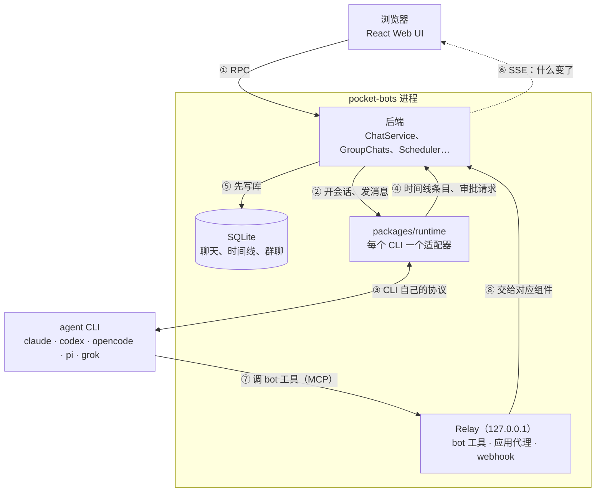

# Pocket Bots

跑在你自己电脑上的个人 bot。每个 bot 有自己的指令、模型、长期记忆、技能、MCP 工具和连接的应用；你可以和它聊天，让它按计划或在收到 webhook 时自己干活，还能把几个 bot 拉进一个群聊，让它们分工协作。

pocket-bots 直接驱动五个编码 agent 的 CLI：**Claude Code、Codex、OpenCode、Pi、Grok Build**。每个 CLI 用它**自己已经登录的账号和订阅额度**；pocket-bots 不保存、不注入任何 API key。

- 有哪些功能：[docs/features.md](docs/features.md)
- 每个功能怎么用：**[使用指南](docs/USAGE.md)**
- 怎么实现的（组件、通信、agent、bot、群聊）：[docs/design.md](docs/design.md)
- 群聊里几个 bot 怎么协作（完整规则和例子）：[docs/group-chats.md](docs/group-chats.md)
- 群聊的通信协议（给开发者：消息怎么流动、每一步读写什么、各种组合下谁收到）：[docs/group-protocol.md](docs/group-protocol.md)

> **关于 Claude**：Claude 通过 Claude Agent SDK 驱动你本机装好的 `claude`，用的是你自己的 claude.ai 登录。Anthropic 不允许第三方产品向别人提供 claude.ai 登录，所以这部分只供你个人使用。

## 五个 agent

| Agent | 怎么驱动 | 插话进正在跑的一轮 | bot 工具 | 审批 |
|---|---|---|---|---|
| Claude Code | Claude Agent SDK（本机 `claude`） | ✅ 当前工具调用结束后 | HTTP MCP（`bots`） | `canUseTool` |
| Codex | `codex app-server`（JSON-RPC） | ✅ `turn/steer` | 动态工具（不经过 MCP 审批） | server request |
| OpenCode | `opencode serve` + `@opencode/client` v2 | ✅ `delivery: "steer"` | HTTP MCP（每个会话一个 server） | 权限规则 + `permission.asked` |
| Pi | `pi --mode rpc` + pocket-bots 的扩展 | ✅ RPC `steer` | 扩展注册的 MCP（Pi ≥ 1.0） | 扩展的 `tool_call` 钩子 |
| Grok Build | ACP：`grok agent stdio` | ✅ `_x.ai/interject` | ACP 的 MCP 服务器 | `session/request_permission` |

所有审批都由 pocket-bots 自己回答：bot 自己的工具免审批，其余按 bot 的审批模式弹卡片。每个 agent 都通过同一套合同测试（调用工具、审批、插话被接收并执行、打断、换进程后续接），见 `packages/runtime/test/contract.ts`。

## 安装

需要：

1. **Node.js 24 或更新**（用到内置的 `node:sqlite`）。
2. **至少一个登录好的 agent CLI。** 比如在终端里运行一次 `claude` 并登录；其他的：`codex login`、`grok`（登录 grok.com）、`opencode`、`pi`（`/login`）。

然后：

```bash
git clone https://github.com/hustnn/pocket-bots.git
cd pocket-bots
npm install
npm run build          # 构建 Web UI
```

## 启动

```bash
npm start
```

打开 <http://127.0.0.1:6880>。左上角列出已经就绪的 agent。点 **New bot** 建第一个 bot，见[使用指南](docs/USAGE.md)。

后端要一直开着：聊天会话、群聊投递、每日日志、记忆改动记录、定时任务、webhook、排队消息都靠它。长期用的话，装成登录后自动启动的服务（macOS 用 launchd，Linux 用 systemd）：

```bash
npm run service -- install     # 还有 status、uninstall、print
```

见[使用指南](docs/USAGE.md#1-准备工作)。

## 配置

数据目录默认是 `~/.pocket-bots`，可以用环境变量 `POCKET_BOTS_HOME` 改。里面有 `bots.json`（bot 和库）、`pocket-bots.sqlite`（聊天、时间线、群聊）、`Bots/<botId>/`（每个 bot 的工作目录、记忆和技能）。可以放一个 `config.json`：

```json
{
  "web": { "host": "127.0.0.1", "port": 6880, "hostnames": [] },
  "relay": { "port": 6881 }
}
```

| 配置项 | 环境变量 | 默认值 | 说明 |
|---|---|---|---|
| `web.host` | `POCKET_BOTS_HOST` | `127.0.0.1` | Web UI 监听的地址 |
| `web.port` | `POCKET_BOTS_PORT` | `6880` | Web UI 端口 |
| `web.hostnames` | `POCKET_BOTS_HOSTNAMES`（逗号分隔） | `[]` | 额外放行的域名（防 DNS rebinding） |
| `relay.port` | `POCKET_BOTS_RELAY_PORT` | 第一次用 `6881`，之后一直沿用 | bot 工具、应用代理和 webhook 用的本机端口 |

- **同一个数据目录只能跑一个 pocket-bots。** 要同时跑两个，给第二个一个单独的 `POCKET_BOTS_HOME`。
- **Web UI 没有登录。** 默认只监听 `127.0.0.1`。要从别的设备访问，只在可信网络里打开（比如 Tailscale），或放在带认证的反向代理后面。

## 工作原理

pocket-bots 是你电脑上的一个 Node 进程，夹在浏览器和 agent CLI 中间：你在页面上操作，它驱动 CLI 干活，再把 CLI 的输出存下来给你看。图里每个箭头有编号，下面按编号解释。



图里的方框：

- **后端**：bot、聊天、群聊、定时任务、记忆这些业务都在这里。
- **packages/runtime**：只管驱动一个 agent 会话（打开、发消息、插话、打断、审批、续接），不知道 bot 和群的存在。
- **SQLite**：数据目录里的 `pocket-bots.sqlite`。bot 的配置不在这里，在 `bots.json`。
- **Relay**：只监听 127.0.0.1 的 HTTP 服务（默认端口 6881），让 agent 能反过来调用 pocket-bots。
- **agent CLI**：本机装好、登录好的 CLI，在 pocket-bots 进程之外单独运行，用它自己的账号。

发一条消息时（①–⑥）：

- **① 浏览器 → 后端**：页面上的每个操作都是一次 RPC（`POST /api/rpc/<name>`），发消息、点审批卡片都是。
- **② 后端 → runtime**：后端用 bot 当前的配置（system prompt、记忆、工具）打开这个聊天的会话；开过的就用存下的会话 id 续接。会话空闲 15 分钟后关掉，下次发消息再续接，每次打开都带上 bot 最新的配置；不过 Claude Code 和 Codex 续接时不认新的 system prompt，继续用会话开始时那份。
- **③ runtime ↔ CLI**：每个适配器用这个 CLI 自己的协议发消息、收输出，见上面「五个 agent」的表。
- **④ runtime → 后端**：五个 CLI 的输出被统一成同一种时间线条目：用户消息、回复、思考、工具调用及其详情。CLI 要审批时，免审批的工具（pocket-bots 自己的读取、提议和群聊工具，你在 **Access** 里勾上的 MCP 工具）在适配器里直接放行；其余的交给后端：命中命令白名单或信任的目录就放行，剩下的在聊天里弹卡片，你点了之后经 ① 回来。哪些操作需要审批由 CLI 自己的审批模式决定，pocket-bots 只决定怎么回答。
- **⑤ 后端 → SQLite**：每个条目先写进 SQLite，再通知页面。进程随时被杀，重启后看过的内容都还在。
- **⑥ 后端 → 浏览器**：SSE 只告诉页面「什么变了」，不带数据（所以是虚线），页面再经 ① 拉新内容。

agent 反过来调用 pocket-bots 时（⑦–⑧）：

- **⑦ CLI → Relay**：agent 调 pocket-bots 自己的工具（`ask_bot`、群聊工具、提议卡片……）或连接的应用（Gmail、Slack……）时，经 MCP 连到 relay。每个聊天的 MCP 配置里带一个 token，relay 凭它认出是哪个 bot 的哪个聊天。Codex 例外：pocket-bots 自己的工具由 Codex 适配器替它转发给 relay。
- **⑧ Relay → 后端**：pocket-bots 自己的工具交给对应的组件执行，比如 `group_send` 交给群聊。连接的应用不进后端：relay 检查这个 bot 能用这个应用后，加上你的 Composio key 转发出去。

Relay 方框里的 webhook 不是 agent 调的：别的程序 POST 到 `http://127.0.0.1:<relay 端口>/hooks/<routineId>/<secret>`，后端开一个新聊天跑这个定时任务，从 ② 开始走同样的流程。relay 只监听 127.0.0.1，所以调用方必须在同一台电脑上。

群聊用的也是这几条通道。每个 bot 在群里有一个**座位**，就是一个普通聊天，走 ②–⑥。bot 只能用群聊工具（⑦⑧）读写群，它在座位里直接输出的文字不进群。有新消息时，后端经 ② 往座位发一条提示，只说哪里有几条新消息，由 bot 自己调 `group_read` 去读；bot 调 `group_send` 发言前，后端先检查它有没有漏看新消息；几个 bot 分工时，先用 `group_claim` 认领再动手。完整规则见 [docs/group-chats.md](docs/group-chats.md)，消息怎么流动见 [docs/group-protocol.md](docs/group-protocol.md)，组件和通信的细节见 [docs/design.md](docs/design.md)。

## 开发

```bash
npm run dev            # 后端 + Vite
npm run typecheck
npm test               # 单元测试和端到端测试（用脚本化的假 agent，不调模型）
npm run test:live -- claude      # 合同测试，跑真的 CLI：claude / codex / opencode / grok / pi / pi-fake
node packages/runtime/test/live-commands.ts codex   # 列出这个 CLI 的斜杠命令，再跑一次 /compact
node packages/runtime/test/live-directories.ts      # Codex 在额外目录里写文件不弹审批，中途换的列表下一轮生效
```

`npm run dev` 的页面在 <http://127.0.0.1:5180>，`/api` 转发给 6880 端口的后端。给 coding agent 看的开发说明见 [AGENTS.md](AGENTS.md)。

## 源码目录结构

代码分两个包（npm workspaces）：`packages/runtime` 直连五个 CLI，不知道 bot 和群的存在；`packages/app` 是 pocket-bots 本身。

```
pocket-bots/
├── package.json                 workspaces 根：build / start / dev / typecheck / test 脚本
├── docs/                        功能、使用指南、设计、群聊规则和通信协议
├── packages/
│   ├── runtime/                 运行时层（@pocket-bots/runtime）
│   │   ├── src/
│   │   │   ├── types.ts             统一接口：RuntimeAdapter、RuntimeSession、RuntimeEvent、TimelineItem
│   │   │   ├── adapters/            claude、codex、opencode、pi、grok 五个适配器，fake（脚本化，测试用）
│   │   │   ├── session-base.ts      适配器共用的会话状态、监听器、本地队列
│   │   │   ├── tool-detail.ts       工具调用 → 时间线里的结构化详情（命令、diff、读文件…）
│   │   │   ├── questions.ts         各 CLI 的提问工具 → 统一的 question 审批
│   │   │   ├── env.ts               启动 CLI 前清理子进程环境
│   │   │   └── jsonrpc.ts、mcp-client.ts、util.ts
│   │   └── test/                单元测试；contract.ts 合同测试；live*.ts 跑真 CLI
│   └── app/                     pocket-bots 应用（@pocket-bots/app）
│       ├── src/
│       │   ├── server/              后端（Node + Hono）
│       │   │   ├── main.ts              启动与装配：建各组件、连事件、起 HTTP 和 relay
│       │   │   ├── http.ts、rpc-handlers.ts、events.ts、hosts.ts    RPC 路由、SSE、Host 头检查
│       │   │   ├── store.ts、db.ts      bots.json；SQLite 和版本化迁移
│       │   │   ├── host.ts、providers.ts    给各功能用的门面；探测 CLI 装没装、登没登录
│       │   │   ├── chat-service.ts、supervision.ts    每个聊天的 runtime 会话和看护
│       │   │   ├── chats.ts、prompt.ts  由 bot 配置生成 SessionSpec 和 system prompt
│       │   │   ├── groups.ts、group-store.ts、briefing.ts、reminders.ts    群聊
│       │   │   ├── relay.ts、tools/     127.0.0.1 上的 MCP relay；bot 工具和群聊工具
│       │   │   ├── scheduler.ts、queue.ts、answers.ts    定时任务和 webhook、排队消息、ask_bot
│       │   │   ├── memory.ts、journal.ts、activity.ts    记忆、改动记录、每日日志
│       │   │   ├── library.ts、mcp-probe.ts、composio.ts、search.ts    技能和 MCP 库、连接的应用、搜索
│       │   │   └── config.ts、instance.ts、service.ts …    配置、单实例锁、launchd / systemd 服务
│       │   ├── shared/              前后端共用：zod 模型（bot.ts、group-chat.ts）、RPC 定义（rpc.ts）、纯逻辑
│       │   └── web/                 React 单页应用
│       │       ├── app/                 页面：侧栏、聊天、群聊、bot 面板、库、设置
│       │       ├── chat/                聊天流的纯逻辑：时间线 → 行、输入框、提问表单
│       │       ├── components/          通用组件
│       │       └── lib/                 RPC 客户端、React Query、SSE 订阅、路由、草稿
│       ├── tests/               vitest：单元测试和端到端测试（用 fake runtime）
│       └── scripts/dev.mjs      同时跑后端（tsx watch）和 Vite
├── spikes/                      早期验证各 CLI 协议的脚本，不参与构建和测试
└── third_party/                 改写来源的许可证
```

每个组件负责什么、怎么通信，见 [docs/design.md](docs/design.md#2-组件)。

## 致谢

pocket-bots 参考了这些项目，感谢它们的作者：

- **[Raft](https://github.com/botiverse/raft-source)**：多个 agent 在一个群里怎么协作而不乱，群聊的设计从它那里学到了很多。
- **[Paseo](https://github.com/getpaseo/paseo)**：运行时层的 agent 适配器、时间线和工具调用的形状，以及聊天界面的很多细节，改写自 Paseo 的代码（Apache-2.0）。
- **[paseo-bots](https://github.com/oliexe/paseo-bots)**：bot、记忆、技能、定时任务、提议卡片这些 bot 功能最早的实现（MIT）。

也参考了 [grok-bot](https://docs.x.ai/grok-bot/chat-and-collaboration)（群聊和 bot 的产品形态）、OpenMausBot（bot 功能的细节）和 [pi](https://github.com/earendil-works/pi)（SQLite 存储的做法）。

## 许可

MIT，见 [LICENSE](LICENSE)。包含改写自其他项目的代码，许可和版权说明见 [NOTICE](NOTICE)。
