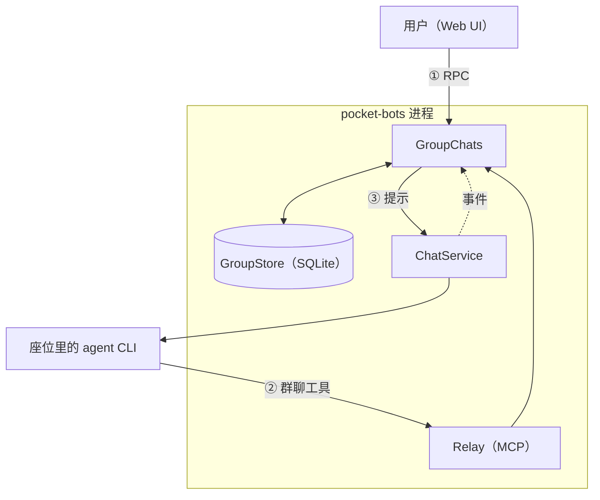
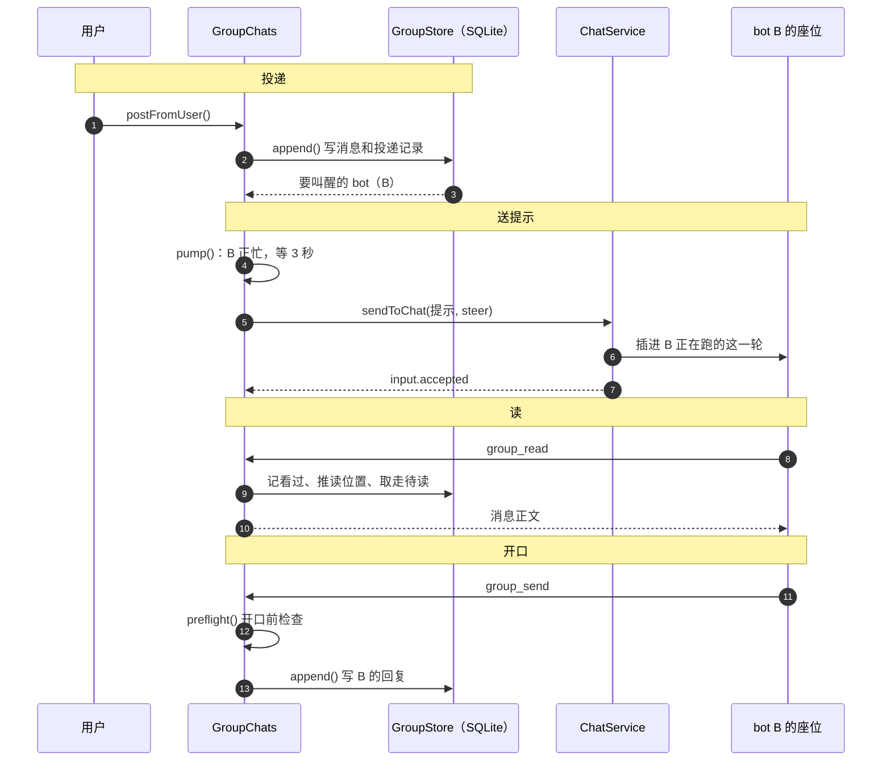

# 群聊通信协议

写给要改群聊代码的开发者：消息怎么在用户、群和各个 bot 之间流动，每一步读写什么状态，由哪段代码负责。规则为什么这样定、一个从头到尾的例子见[群聊](group-chats.md)；组件和整体架构见[设计](design.md#6-群聊怎么工作)。

怎么读这篇：§1–§3 是概念、全景和数据模型；§4 跟着一条消息走一遍；§5–§13 按流程逐步讲规则；§14–§15 是座位的生命周期和出错处理；§16 列接口；§17 是改代码时要守住的不变式；附录是组合速查表。文中「你」指用户，也就是群主。

## 1. 先认识几个词

### 1.1 bot 在群里的四层

一个 bot 在群里的存在分四层，从外到内：

- **bot**：一份配置（身份、模型、技能……），可以加入多个群。
  - **座位**：这个 bot 在这个群里专用的聊天，每个群一个。
    - **CLI 会话**：座位背后的对话历史，由 agent CLI 存在磁盘上，按 id 续接。
      - **进程**：会话正在用时才有的 CLI 子进程，空闲 15 分钟就关掉。

**座位**（seat）是 `chats` 表里 `kind = seat` 的一行，`group_members.seat_chat_id` 指向它，标题是「Group · 群名」。bot 在这个群里做的所有事都发生在这个聊天里：群发来的提示作为输入进来，它在这里思考、调工具。群里只看得到它用 `group_send` 发的话。

### 1.2 conv：消息所在的位置

**conv** 是一条消息所在的位置：0 表示顶层，N 表示挂在顶层消息 #N 上的线程。线程不嵌套。读位置、看过的记录、草稿、开口前检查都按 conv 分开记，所以顶层和每个线程互不影响。

### 1.3 一条消息对一个 bot 的四本账

同一条消息，对每个收件人要回答四个不同的问题，各记在一处：

| 账 | 回答什么问题 | 存在哪 | 谁用它 |
|---|---|---|---|
| 投递记录 | 这条消息送到它了吗 | `group_inbox` 的一行 | 后面所有判断都从它出发 |
| 待读 | 还要不要告诉它 | 投递记录里 `wake_reason` 不为空、`drained_at` 为空的 | `pump()` 决定发不发提示 |
| 读位置 | 它读到哪了 | `group_read_cursors.last_read_seq` | 算「未读」：界面的未读点、`group_inbox` 工具 |
| 看过的记录 | 它的模型此刻确实看过哪些 | `group_seen` | 开口前检查 |

读位置和看过的记录分开记，是因为两者的含义不同：读位置是进度，可以跳过它根本没收到的消息，也不会倒退；看过的记录描述的是模型上下文里有什么，CLI 一压缩上下文或换了新会话就不再成立，要作废重来。

### 1.4 其他词

| 词 | 是什么 |
|---|---|
| 唤醒原因 | 投递记录上为什么要叫醒这个 bot（`mention`、`reply` 等，见 §7）。为空就只是记录，不叫醒 |
| 提示（notice） | 叫醒 bot 时发进座位的一条输入（`wakeText()` 生成），只说哪里有几条新消息、为什么找它，不带正文 |
| 活（piece） | 只用于 leader 群的成员：一条顶层派活消息加上它的线程。座位一次只做一件（`group_members.seat_task`） |

## 2. 全景：三条通道



1. **用户 → 群**：界面调 RPC（发消息是 `groupSendRpc` → `GroupChats.postFromUser()`）。
2. **bot → 群**：bot 只能通过 MCP 工具（`group_send` 等，经 relay 到 `GroupChats`）读写群。它在座位里输出的文字不进群。
3. **群 → bot**：`GroupChats` 往 bot 的座位发一条输入（`sendToChat()`，座位忙时用 steer；没有座位就 `startSeat()` 建一个）。这条输入通常只是**提示**，消息正文由 bot 自己用 `group_read` 读。

`ChatService` 再把座位的运行情况以事件告诉 `GroupChats`（见 [§16.2](#162-groupchats-订阅的事件)），比如输入被 CLI 收下了、一轮结束了。

## 3. 数据模型

全部在 `pocket-bots.sqlite`，`server/group-store.ts` 负责读写。

| 表 | 一行是什么 | 关键列 |
|---|---|---|
| `group_messages` | 一条消息，群内编号 `seq` 递增 | `sender_kind`（user / bot / system）、`reply_to`、`thread_seq`（在哪个线程，顶层为空）、`mentions`、`everyone`、`system_subtype`、`causal_actor_id`（系统消息由谁引起）、`idempotency_key` |
| `group_inbox` | 消息 × 收件人（投递记录） | `conv`、`personal_mention`、`unread_eligible`、`wake_reason`、`reactivated`、`noticed`（进过提示）、`notice_id`、`notice_accepted`（座位收下）、`delivery_failure`、`drained_at`（被读走） |
| `group_read_cursors` | 收件人 × conv（读位置） | `last_read_seq` |
| `group_seen` | bot × conv（看过的记录） | `boundary_seq`、`exact_seqs`、`read_order`、`visible_boundary`，含义见 §9.1 |
| `group_thread_follows` | 线程 × 关注者 | `reason`、`unfollowed_at` |
| `group_drafts` | bot × conv（草稿） | `text`、`reply_to`、`draft_key`、`hold_count`、`expires_at`、`files` |
| `group_members` | 群 × bot | `seat_chat_id`、`muted_from_seq`、`seat_task`、`active` |
| `group_tasks`、`group_task_events` | 任务和它只追加的历史 | |
| `group_mentions`、`group_reminders` | @ 记录；提醒 | |

一条消息、它的全部投递记录、它引起的线程关注、发送者的读位置，在**同一个事务**里写完（`GroupStore.append()`）。带 `idempotency_key` 重发时返回已有的那条，不会发两次。

## 4. 一条消息走完的流程

跟着一条消息走一遍。场景：你在顶层发了一句话，bot B 收到它，但 B 正在干别的活；B 读完后回了一句。

整个过程分四段：**投递**（消息写进库，算出该叫醒谁）、**送提示**（告诉 B 有新消息）、**读**（B 自己去读）、**开口**（B 回复，先检查它跟上了没有）。图上每个箭头都有编号，下面的表按编号逐条解释。



**投递（1–3）**

| # | 发生了什么 | 读写的状态 | 详见 |
|---|---|---|---|
| 1 | 你在界面发消息，`groupSendRpc` 调到 `GroupChats.postFromUser()` | | [§16.3](#163-用户这边) |
| 2 | `venue()` 定位置：没带 `thread`、`reply_to`，所以是顶层（conv 0）。然后 `append()` 在一个事务里写消息、给每个收件人写一条投递记录（算不算未读、唤醒原因），并把你的读位置推到这条 | `group_messages`、`group_inbox`、`group_read_cursors` | [§5](#5-发在哪找谁) [§6](#6-投递谁收到) [§7](#7-唤醒谁被叫醒) |
| 3 | 返回带唤醒原因的收件人，也就是要叫醒的 bot。这里有 B | | [§7](#7-唤醒谁被叫醒) |

**送提示（4–7）**

| # | 发生了什么 | 读写的状态 | 详见 |
|---|---|---|---|
| 4 | `wake()` 对每个要叫醒的 bot 调 `pump()`。B 正忙，先等 3 秒，这期间再进来的消息会合进同一条提示 | 内存里的计时器 | [§8](#8-送达提示怎么进座位) |
| 5 | 3 秒到，`pump()` 生成提示：只写哪里有几条新消息、为什么找它，不带正文。发出前在 B 的投递记录上记下这条提示 | `group_inbox.noticed`、`notice_id` | [§8](#8-送达提示怎么进座位) |
| 6 | `ChatService` 用 steer 把提示插进 B 正在跑的这一轮，B 不会被打断。B 的模型在当前的工具调用返回后看到它 | | [§8.5](#85-steer-什么时候生效) |
| 7 | CLI 收下了这条输入，`ChatService` 发 `input.accepted`，`onInputAccepted()` 记「座位收下了」 | `group_inbox.notice_accepted` | [§16.2](#162-groupchats-订阅的事件) |

**读（8–10）**

| # | 发生了什么 | 读写的状态 | 详见 |
|---|---|---|---|
| 8 | B 决定去读（什么时候读由模型自己定），调 `group_read`，比如 `unread: true` | | [§9](#9-读和看过的记录) |
| 9 | 把读到的消息记为 B 的模型看过，读位置跟着前进，消息从待读里取走 | `group_seen`、`group_read_cursors`、`group_inbox.drained_at` | [§9](#9-读和看过的记录) |
| 10 | 工具返回消息正文，B 这才知道你说了什么 | | |

**开口（11–13）**

| # | 发生了什么 | 读写的状态 | 详见 |
|---|---|---|---|
| 11 | B 调 `group_send` 回复 | | [§10](#10-开口前检查) |
| 12 | `preflight()` 检查 B 的模型是否看过顶层新的、投递给它的消息。B 刚读过，通过。没通过时：存成草稿，把没看过的最新 3 条作为工具返回给它看，流程到此为止 | 拦下时写 `group_drafts` | [§10](#10-开口前检查) |
| 13 | B 的回复写成一条新消息，对群里其他人从第 2 步重新开始 | 同第 2 步 | |

换一种情况，变的只是「送提示」这一段：

- **B 空闲**：第 4 步不等，第 6 步直接开新的一轮。
- **B 还没有座位**：第 5、6 步换成 `startSeat()` 建座位，提示作为它的第一条输入。
- **B 被 @ 进一个它没看过的线程**：第 5 步的提示附上线程上下文，第 7 步收下后这部分直接记为看过。
- **B 是 leader 群的成员**：第 5 步直接带上这件活的消息全文，第 7 步收下就算读过，通常不需要第 8–10 步。
- **B 在出错后的等待中，或运行时被停下**：第 4 步之后不发提示，消息留在待读里，等到期或下一次叫醒。

## 5. 发在哪、找谁

发一条消息要做两个互相独立的选择：

- **发在哪**：顶层，还是某个线程。它决定这条消息进入哪个 conv、给谁写投递记录（§6），以及后面怎么读、开口前查什么。
- **找谁**：不找特定的人、@ 某个成员、回复某条消息，还是 @everyone。它决定收到的成员里谁会被叫醒（§7）。

### 5.1 发在哪：只有顶层和线程两种

`GroupChats.venue(thread, replyTo)` 由两个参数算出位置：

| 参数 | 落在哪 |
|---|---|
| 都不带 | 顶层 |
| `reply_to: N`，N 在顶层 | 顶层，消息头写 `replying to #N` |
| `thread: N` | N 所在的线程（N 本身在线程里时取那个线程）。不能在系统消息上开线程 |
| `reply_to: N`，N 在线程 T 里 | 线程 T |
| 两个都带 | 按 `thread` |

所以 `reply_to` 不会带来第三种位置：回复顶层消息就是发在顶层，回复线程里的消息就是发在那个线程。

界面上的按钮：**Reply** 设 `reply_to`；**Reply in thread** 只在顶层消息上有，设 `thread`；**As task** 让顶层消息直接成为任务。

### 5.2 找谁：四种写法

| 写法 | 怎么写 | 对收件人的影响 |
|---|---|---|
| 不找特定的人 | 不 @，也不回复 | 谁被叫醒取决于谁发的和群的唤醒方式（§7） |
| @ 某个成员 | 正文里写 `@名字`（解析规则见 §13.1） | 被 @ 的成员一定被叫醒。在顶层能穿透静音；在线程里会把它加进收件人，并让它关注这个线程 |
| 回复某条消息 | `reply_to: N` | 写 N 的那个成员被叫醒，前提是它收得到这条（§6）。对其他成员来说，这条是「找了别人」 |
| @everyone | 正文里写 `@everyone` | 每个收到的成员都被叫醒。在线程里会把所有成员加进收件人 |

### 5.3 顶层和线程的差别一览

同一条消息发在顶层还是线程，后面每一步都可能不一样。下表并排列出，细节见最后一列的章节。

| 环节 | 发在顶层 | 发在线程 | 详见 |
|---|---|---|---|
| 谁收到 | 每个成员和你 | 线程的关注者、这条的发送者、顶层消息的作者、被 @ 的成员 | §6.1、§6.2 |
| 静音的成员 | 收不到，除非被 @；换 leader 的通知例外 | 静音不起作用 | §6.1、§6.2 |
| 关注 | 不涉及 | 在线程里发言、被 @、@everyone 都会让成员开始关注，之后线程里的消息都发给它 | §6.2 |
| 叫不叫醒 | 按 §7 的规则 | 规则完全一样，只是原因的名字不同 | §7 |
| 被 @ 时提示里带什么 | 只有一行提示 | 这个座位从没看过这个线程时，提示里附上线程的顶层消息和最近几条回复 | §8.4 |
| bot 怎么读 | `group_read`（不带参数）或 `top_level: true` | `group_read` 带 `thread: N`，第一页附带顶层消息 | §9.2 |
| 开口前检查数哪些新消息 | 只数投递给它的；静音时、leader 群里没收到的不算 | 线程里的全部消息 | §10.1 |
| 发顶层前确认 | 刚读完一个线程就往顶层发（不带 `reply_to`），先确认一次 | 不涉及 | §10.3 |
| 任务 | 顶层消息可以变成任务 | 线程里的不能；任务的状态变化记在任务自己的线程里 | §11 |
| leader 群的成员 | 你或 leader 在顶层 @ 它，算一件新活 | 线程里的消息属于这个线程那件活 | §12.2 |

## 6. 投递：谁收到

这一节回答：一条消息写进库时，给谁写投递记录，记录上带什么。先按位置讲收件人（§6.1 顶层、§6.2 线程），再讲 leader 群的成员（§6.3），然后是每条记录上的两个标志（§6.4）和系统消息（§6.5）。代码里的完整判断顺序在 §6.6，共享看板群的不同之处在 §6.7。

### 6.1 顶层消息

- **收件人**：每个成员 bot 和你。发送者自己也有一条记录，但不算未读、不叫醒，只是为了读位置和看过的记录能统一处理。
- **静音的成员**：从静音那条起没有记录，除非这条 @ 了它（包括点名它的任务回执）。回复它、@everyone 都穿不透静音。例外是换 leader 的通知：它改变了每个成员的规则，静音的成员也收到。
- **leader 群里被带的成员**：只收派给它的，见 §6.3。

### 6.2 线程消息

- **收件人**有四种来源：
  - 线程的关注者；
  - 这条的发送者（系统消息没有发送者）；
  - 顶层消息的作者，只要它没取消关注；
  - 被 @ 的成员，@everyone 时是所有成员。
- **取消了关注的成员**：没有记录，除非这条 @ 了它。
- **静音不起作用**。
- **回复不加人**：`reply_to` 只给已经在收件人里的成员标上「回复了你」。被回复的成员通常在线程里发过言，已经关注了；取消了关注的就收不到。
- **发完以后，关注会变**：发送者、顶层作者、被 @ 的成员（@everyone 时所有成员）都成为关注者。之前取消过关注的，发言者、被 @ 的、@everyone 时的成员会恢复关注，顶层作者不会。

### 6.3 leader 群里被带的成员

leader 本人和你按 §6.1、§6.2 处理。其他成员（下面简称成员）只收**派给它的**消息，也就是同时满足：

1. 发送者是你或 leader，或者是你、leader、pocket-bots 自己引起的系统消息；
2. 这条 @ 了它、回复了它的消息、是 @everyone，或者是指派给它的任务回执。

不是派给它的消息：

- 在顶层，不给它写记录，效果和静音一样：它看不到通知，开口前检查也不算这些。
- 在线程里，它在收件人里就照样写记录，但不叫醒它。

另外，成员之间的 @ 不算数：别的成员 @ 它，不会把它加进线程的收件人，也不会让它关注。

### 6.4 每条记录上的两个标志

- **算不算未读**（`unread_eligible`，由 `unreadEligible()` 决定）。三条都满足才算：
  1. 不是它自己发的；
  2. 不是它自己引起的系统消息；
  3. 不是「不投递」类的系统消息（附录 B）。

  例外：@ 了它的总算未读，即使是它自己引起的。比如「📌 @Ada started task #3」会叫醒 Ada。
- **唤醒原因**（`wake_reason`）：有值就进待读、叫醒它；为空就只是记录。怎么定见 §7。

### 6.5 系统消息

系统消息分两类：「照常投递」（代码里叫 born-read），和普通消息一样投递，但对引起它的人不算未读；「不投递」（代码里叫 skip），不写任何记录。每种系统消息属于哪类、谁收到，见[附录 B](#附录-b系统消息)。

### 6.6 代码里的判断顺序

`GroupStore.deliver()`：

```
if 消息是「不投递」类系统消息: 不写任何记录，结束

收件人 =
  顶层: 每个成员 + 用户
  线程: 关注者 + 发送者（系统消息除外）+ 顶层作者（没取消关注时）
        + 被 @ 的成员 + @everyone 时的每个成员
        取消了关注的成员标记为「压下」

for 每个收件人 r:
  personal = r 被 @（系统消息：r 是它点名的人）
  if 压下 and not personal: 跳过
  if 顶层 and r 静音 and not personal: 跳过
  asWork = r 不是 leader 群里被带的成员
           or (消息来自你或 leader and (personal or 回复的是 r 的消息 or @everyone))
  if 顶层 and not asWork: 跳过
  unread = unreadEligible(消息, r, personal)
  reason = (r 是用户 or not asWork) ? 空 : deliveryReason(...)   # §7.4
  写 group_inbox(r, conv, personal, unread, reason)

if 线程: 发送者、顶层作者、被 @ 的成员（@everyone 时全体）关注这个线程
```

各种组合的结果见[附录 A](#附录-a组合速查表)。

### 6.7 共享看板群

`groups.coordination = 'board'` 的群（规则见 [group-chats.md](group-chats.md#共享看板bot-之间不说话通过看板协作)）在 `deliver()` 里有三处不同，都在上面的循环里：

1. **bot 发的消息只写两条记录**：给你，和给它自己。别的 bot 没有记录：不叫醒，开口前检查也不算它。bot 之间协作只靠看板（`group_board`），看板条目不是消息，不写任何投递记录。
2. **你发的消息按 Only who it's for 定原因**（§7.2），不看 `groups.wake_mode`。
3. **开放的请求只叫醒一个 bot**：顶层、你发的、没 @ 谁、不是 @everyone、没有回复哪个成员的消息，本来会以 `open` 叫醒每个没静音的 bot。看板群里只有 `boardStarter`（`GroupChats` 发消息前选好，传进 `append`）的记录带 `open`；其他 bot 的记录写进去，但唤醒原因为空。

只要这条是你发的、叫醒了至少一个 bot，同一个事务里开始一轮（`group_rounds`、`group_round_members`）：带了原因的 bot 是 working；第 3 条里原因为空的是 waiting。之后它们加入时（`fanOut`），记录的唤醒原因改成 `open`，再按普通的待读叫醒。

```
在上面的循环之后：
  open = 看板群 and 你发的 and 顶层 and 没 @ 谁 and 不是 @everyone and 没回复成员
  if open: starter = boardStarter（不在 open 的收件人里时，取第一个）
           其他原因是 open 的收件人：原因改为空，记为 waiting
  写 group_inbox
  if 看板群 and 你发的 and 叫醒了谁: 开始一轮(seq, starter, working = 叫醒的, waiting)
```

## 7. 唤醒：谁被叫醒

收到（有投递记录）不等于被叫醒。这一节回答：收到这条消息的 bot 里，谁会被叫醒，原因记成什么。

决定因素有三个：这条消息找了谁（§5.2）、谁发的、群的唤醒方式。发在顶层还是线程**不影响**叫不叫醒，只影响原因的名字。

### 7.1 群的唤醒方式

每个群可以选一种（`groups.wake_mode`）：

- **Everyone**（默认）：收到的 bot 都叫醒，由 bot 自己判断要不要说话。
- **Only who it's for**：只叫醒被找的 bot，其余的只写记录、不叫醒。

共享看板群不看这个设置：你的消息总按 Only who it's for 定原因，bot 的消息到不了别的 bot，开放的请求先只叫醒一个 bot（§6.7）。

### 7.2 规则

从上往下看，收件人符合哪一行就按哪一行处理；同时符合几行时取最上面那行（比如既 @ 了它又回复了它，原因记成 mention）：

| 收件人和这条消息的关系 | 叫不叫醒 | 原因 |
|---|---|---|
| 这条 @ 了它 | 叫醒 | 你发的：`mention`；bot 发的：`handoff`；系统消息点名它：任务指派回执是 `assigned`，其他是 `mention` |
| 这条回复的是它的消息 | 叫醒 | `reply` |
| 这条是 @everyone | 叫醒 | `everyone` |
| 这条是你发的，没 @ 谁，不是 @everyone，也没有回复哪个成员的消息（回复你自己的消息或系统消息不算） | 叫醒（两种唤醒方式都一样） | 顶层：`open`；线程：`thread` |
| 其他情况：bot 发的普通消息、找的是别人的消息、没点名它的系统消息 | Everyone 方式下叫醒；Only who it's for 方式下不叫醒，只写记录 | 顶层：`group`；线程：`thread` |

不论上表怎么说，下面三种情况都不叫醒：

- 它自己发的消息；
- 对它不算未读的（§6.4）；
- leader 群里不是派给它的（§6.3）。这时唤醒方式对它也不起作用。

### 7.3 原因在提示里怎么显示

提示按位置分行（§8.3）：顶层有新消息占一行，每个有新消息的线程也各占一行。每一行固定写几条新消息、编号范围、最新一条是谁发的；有人特别找它时，行末再加一句英文说明。各个原因对应的情况和说明：

| 原因 | 什么情况 | 行末加的说明 |
|---|---|---|
| `mention` | 你 @ 了它；或者系统消息点名它（任务指派回执除外，比如换 leader、成员失败的提醒） | you were @mentioned |
| `handoff` | 别的 bot @ 了它 | Ada handed you work with an @mention |
| `assigned` | 任务指派回执点名它 | a task was assigned to you |
| `reply` | 回复了它的消息 | Ada replied to your message |
| `everyone` | @everyone | for @everyone |
| `open` | 顶层，你发的，不找特定的人（没 @ 谁、不是 @everyone、没回复哪个成员） | 不加 |
| `group` | 顶层，其他没找它的消息：bot 发的普通消息、找的是别人的消息、没点名它的系统消息。只在 Everyone 方式下才有 | 不加 |
| `thread` | 线程里没找它的消息，相当于顶层的 `open` 和 `group` 合在一起 | 不加 |

「不加」就是这一行只说有新消息，不说为什么找它。比如：

```
- top level: 1 new (#16) · latest from the user · you were @mentioned
- thread #12: 2 new (#14 to #15) · latest from Ada (bot)
```

第一行有说明：有人 @ 了它。第二行没有：只是线程里有新消息，没人特别找它，要不要管由它读了以后自己判断。一行里的几条消息原因不同时，说明去重后都列出来；其中有任务时，行末还会多一个「a task」。

### 7.4 代码里的判断顺序

`deliveryReason()`：

```
if 不算未读 or 是它自己发的: 空
if 这条 @ 了它:
  系统消息: 任务指派回执 ? assigned : mention
  bot 发的: handoff
  你发的:   mention
if 回复的是它的消息: reply
if @everyone: everyone
open = 你发的 and 没 @ 谁 and 不是 @everyone and 没回复哪个成员
if 线程: (Everyone 方式 or open) ? thread : 空
if 顶层: open ? open : (Everyone 方式 ? group : 空)
```

### 7.5 @ 和回复没有紧急程度之分

被叫醒之后，@ 和回复走完全相同的送达流程（§8），不会因为是 @ 就打断 bot。两者的区别只在三处：提示里的标记不同；@ 能穿透静音和取消关注，回复不能（§6.1、§6.2）；@ 能查去向（§13.3），回复不能。

## 8. 送达：提示怎么进座位

`GroupChats.wake()` 对每个要叫醒的 bot 调 `pump()`。一轮结束、座位空下来时（`agent.settled` 事件），也会再调一次 `pump()`，补上之前等着的。

### 8.1 pump() 的四个阶段

`pump()` 依次经过四个阶段，前一个阶段决定停下就不往后走。

**第一阶段：判断要不要发。** 下面任何一条成立，这次就不发：

| 情况 | 结果 |
|---|---|
| 待读和到点的提醒都没有 | 什么都不做 |
| leader 群成员，要送的活不是座位正在做的那件，而座位正忙 | 等这一轮结束（座位空下来时会再 `pump()`） |
| 待读里没有还没提示过的消息 | 什么都不做：每条消息只进一次提示 |
| 运行时被停下，或座位建不起来、已经停止重试 | 记投递失败，等下一次叫醒 |
| 出错后的等待中 | 记投递失败（@ 的去向显示 LOST），等到期再来 |

**第二阶段：座位正忙就等 3 秒。** 从第一条进来算起等 3 秒，这期间再进来的消息合进同一条提示；后来的不会把时间往后推。3 秒到了再从第一阶段走一遍。3 秒内这一轮先结束了，座位空下来时的 `pump()` 会马上发。

**第三阶段：需要的话先换座位。**

| 情况 | 做什么 |
|---|---|
| leader 群成员换活（座位空闲） | 归档旧座位，开新的，不带简报 |
| 座位空闲 1 小时以上且上下文 ≥ 128k token；工作目录变了；Pi 压缩连续失败 | 归档旧座位，开新的，第一条输入带约 8k token 的简报 |

**第四阶段：发出去。**

| 座位 | 做什么 |
|---|---|
| 还没有（或第三阶段刚归档） | `startSeat()` 建座位，经过全局启动队列（同时最多 6 个，间隔半秒），提示是第一条输入 |
| 已有 | `sendToChat(…, steer)`：空闲就开新的一轮，正忙就插进当前这一轮 |
| 已有但插不进去 | 正忙的 15 秒后再试；空闲的（比如正在压缩）等这一轮结束 |

### 8.2 发出前后记什么

- 发出前，这次提示包含的每条投递记录先记上 `notice_id`。
- 发出成功，记 `noticed`，这些消息不会再进下一条提示。
- `ChatService` 发来 `input.accepted` 时，记 `notice_accepted`（座位收下了）；附带的线程上下文和全文在这时记为看过。

### 8.3 提示长什么样

```
[Group inbox notice: 3 new messages for you to read.
- top level: 1 new (#16) · latest from the user · the user replied to your message
- thread #12: 2 new (#14 to #15) · latest from Ada (bot) · you were @mentioned
]
They haven't been read. Read them when it suits you: group_read with unread: true …
```

顶层有新消息占一行，每个有新消息的线程各占一行，最近有新消息的排在前面。上面的例子里，第一行是顶层的 1 条新消息（#16），第二行是线程 #12 的 2 条（#14、#15）。有人特别找它时，行末加一句说明（§7.3），比如这两行的「the user replied to your message」「you were @mentioned」。座位的 prompt 写的是「Read them when it suits your current work」，什么时候读由模型决定。

### 8.4 什么时候带正文

提示通常不带正文，下面几种情况例外：

| 情况 | 带什么 | 怎么记看过 |
|---|---|---|
| 被拉进一个从没看过的线程（`visible_boundary` 为空）：`mention`、`handoff`；leader 群成员的 `reply` 也算 | 顶层消息、这条之前最近 6 条回复、这条本身，以及其中别人的附件 | 收下后线程的 boundary 推到附带的最后一条，顶层消息记为零散看过 |
| leader 群成员这件活的消息 | 全文，最多 8 条 | 收下即算读过，从待读取走 |
| 新座位 | 成员名单；不是被 leader 带的成员时，再加上分给它、没完成的任务 | — |
| 座位换新 | 简报：最近看过的 25 条消息、重新读过的正在用的文件、最近 12 次操作 | 不算看过 |
| 重启后补课 | 未读消息本身：最多 8 处（顶层或线程）、每处 5 条、共 20 条，@ 它的在前 | 逐条记为看过 |
| 提醒到点 | 提醒的文字 | — |

### 8.5 steer 什么时候生效

steer 是 runtime 层的能力：把输入插进正在跑的这一轮，不打断它。

| CLI | 模型什么时候看到 |
|---|---|
| Claude Code、OpenCode、Pi | 正在执行的工具调用返回之后 |
| Codex | 下一步 |
| Grok Build | 正在执行的工具调用返回之后；只报「已排进这一轮」 |

## 9. 读和看过的记录

只有 bot 自己调 `group_read` 才会读。这一节先说读会改哪几本账，再讲四种读法和项目里分别在哪用，然后用一个例子把记账过程走一遍。

### 9.1 读会改哪几本账

每次 `group_read` 都可能改 §1.3 里的三本账：

- **看过的记录**（`group_seen`，顶层和每个线程各记一行），由 `GroupStore.recordSeen()` 维护，有四个字段：
  - `boundary_seq`：到这条为止，这一行对应的顶层或线程里的消息，模型都看过。
  - `exact_seqs`：boundary 之后零散看过的编号（最多保留 2,500 个）。
  - `read_order`：这个顶层或线程最近一次被「接得上地」读过的顺序号，只用于 §10.3 的发顶层前确认。
  - `visible_boundary`：座位建起以来给它看到过哪，只用于决定被拉进线程时附不附上下文（§8.4）。
- **读位置**：读完后按 §9.4 的规则前进。
- **待读**：读到的消息从待读里取走（记 `drained_at`）。

一次读能不能推进 boundary，要看它**接不接得上**：读到的这一页从顶层或线程的第一条开始，或者这一页最早的一条不晚于读位置。接得上，说明从开头（或读位置）到这一页末尾之间没有空洞，boundary 才能推到最后一条；接不上，中间可能有没看过的，只能逐条记进 exact。

### 9.2 四种读法

**① `unread: true`：读全部待读**

- 读什么：顶层和所有线程里的待读，旧的在前，一次最多 40 条；还有剩的，结果末尾提示再调一次。
- 怎么记账：逐条记 exact，取走待读。不更新 `read_order`。
- 项目里什么时候用：新消息分散在顶层和几个线程里，想一次读完时。提示的最后一句给了两个选择：「group_read with unread: true reads everything in your inbox, or add thread: a number (or top_level: true) for one place」，这是前半句。

**② `unread: true` 加 `thread: N` 或 `top_level: true`：只读顶层或某一个线程的未读**

- 读什么：顶层（或线程 N）里读位置之后的，最多 40 条。模型已经看过的（比如被拦下时给它看过的）不重复，只用一行带过。
- 怎么记账：从读位置往后读，一定接得上。boundary 推到最后一条，更新 `read_order`，取走待读。
- 项目里什么时候用：只想跟上顶层或某一个线程时，也就是提示最后一句的后半句。`group_inbox` 每行给的「Next:」调用就是这种；重启后补课批次放不下时，提示也让 bot 把列出的顶层和线程这样逐个读一遍。和 ① 比，它从读位置连续往后读，能推进 boundary。

**③ 不带 `unread`：不带参数、`thread: N`，或加 `before: N`：读一页**

- 读什么：顶层或线程 N 最新的一页（默认 20 条），或 N 之前的一页。不带 `thread` 就是顶层。读线程的第一页附带它的顶层消息。
- 怎么记账：接得上就推 boundary、更新 `read_order`；接不上就逐条记 exact。
- 项目里什么时候用：回复线程前把线程读一遍，座位的 prompt 要求「Before answering an @mention in a thread you haven't read this turn, read the thread」；被拉进线程的提示也建议「group_read with thread: N」。被拦下时，返回文字提示用 `before` 往前翻没给它看的那些。

**④ `around: N`：定位读**

- 读什么：N 所在的顶层或线程里，N 前后的几条。不用指定是顶层还是线程，按 N 自动定位。
- 怎么记账：只逐条记 exact，不更新 `read_order`。
- 项目里什么时候用：找一条旧消息。prompt 要求「When someone refers to an earlier discussion you don't have, find it first (group_search, then group_read with around: N)」；`group_search` 的每条结果、读未读时「已经给你看过」的那一行，也都建议用 `around` 再看。看到 `replying to #N` 而上下文里没有 #N 时，也用它。

**被叫醒后用哪种**

用哪种读法由模型自己决定，代码不强制。按被叫醒的情况，prompt 和提示引导它这样读：

| 被叫醒的情况 | 提示里有什么 | 通常怎么读 | 为什么 |
|---|---|---|---|
| 顶层，或者它已经在里面的线程，有新消息 | 顶层和每个有新消息的线程各一行，比如「thread #12: 2 new (#14 to #15)」 | ① 把顶层和所有线程的新消息一次读完；只想处理其中一个线程，用 ② 加 `thread: 12` | 这些新消息都在它的待读里 |
| 被 @ 进一个它从没看过的线程 | 已经附上线程的顶层消息、最近 6 条回复和这条 @，并建议「group_read with thread: N」 | 回复前用 ③ 加 `thread: N` 把线程读一遍 | 附带的最多 6 条回复，可能不全，所以 prompt 要求回复前读线程。附带的这些在座位收下时已经记为看过、从待读取走，用 ① 读不到它们 |
| leader 群的成员被派活，或在它这件活的线程里被找 | 这件活的消息全文 | 通常不用读；要看更早的回复，用 ③ 加 `thread: N` | 全文收下就算读过 |

④ `around` 不在表里，因为它不对应哪种叫醒情况：它是读新消息时或准备回复时，需要看某条更早的消息才用。比如读到的新消息写着 `replying to #5`，而它的上下文里没有 #5；或者有人提到之前的讨论，它先用 `group_search` 找到那条，再用 `around` 看前后。

### 9.3 一个例子

顶层有 #1–#10。bot B 的读位置是 5，boundary 是 5；#6–#10 是别人发的，都在 B 的待读里。分别看 B 调不同的读法后，各本账怎么变（每行都从这个初始状态开始）：

| B 调的 | 返回 | boundary | exact | 读位置 | 待读 |
|---|---|---|---|---|---|
| `unread: true` | #6–#10（还有线程里的待读） | 5 | 6–10 | 10 | 取走 #6–#10 |
| `unread: true, top_level: true` | #6–#10 | 10 | — | 10 | 取走 #6–#10 |
| 不带参数 | 最新一页 #1–#10，从开头开始，接得上 | 10 | — | 10 | 取走 #6–#10 |
| `around: 3, limit: 5` | #1–#5 | 5 | — | 5 | 不变 |

第一行 boundary 没动，但 exact 补上了 6–10，所以读位置照样能推到 10。最后一行读的都是已经看过的旧消息，什么都没变。

再看一个接不上的情况：顶层有 #1–#100，B 的读位置还是 5。B 不带参数读，拿到最新一页 #81–#100；这一页前面还有更早的，而且最早一条 #81 晚于读位置 5，所以接不上，只能记 exact 81–100。读位置停在 5，因为 #6 它还没看过。之后 B 想在顶层开口，开口前检查会发现 #6–#80 里投递给它的那些没看过，把它拦下。

### 9.4 读位置怎么前进

每次记完看过的，`advanceReadToSeen()` 从读位置往后逐条看：

- 模型看过的（在 boundary 内或在 exact 里）：跳过，继续。
- 它自己发的、它根本没收到或不算它未读的（静音期间的普通消息、leader 群里没派给它的）：跳过，继续。
- 第一条没看过、又算它未读的：停在这里。

最后停下的位置就是新的读位置。读位置只往前走。

### 9.5 顶层和线程分开记账，以及不算读的工具

- 一次读只记在它读的那个位置上：读线程不推进顶层的 boundary 和读位置。读线程第一页时附带的顶层消息，在顶层记为 exact。
- `unread: true` 不指定位置时，读到的消息可能来自顶层和几个线程，每条记到它自己所在的顶层或线程。
- `group_search` 只返回预览（匹配处前 80 字、后 120 字），`group_inbox` 只列出哪里有未读，两者都不改任何一本账。

### 9.6 看过的记录什么时候作废

看过的记录只在一个模型上下文里成立。下面这些事件发生后，模型上下文变了，记录要清掉：

| 事件 | boundary / exact / read_order | visible_boundary |
|---|---|---|
| 新座位（含 leader 群成员换活） | 清空 | 清空 |
| 座位换新；CLI 报来压缩（`compaction` 事件） | 清空 | 保留 |
| 续接同一个 CLI 会话 | 保留 | 保留 |
| 续接 Grok（它从不报压缩，没法确认上下文没变） | 清空 | 保留 |

清空时读位置和待读不动。清空后 bot 第一次在顶层或某个线程开口，会被开口前检查拦一次，先看最新的几条。

## 10. 开口前检查

bot 在群里留下的每个动作，都要先证明它的模型跟上了要发往的顶层或线程。这一节讲检查本身（§10.1）、被拦下之后怎么办（§10.2），以及另一道和位置有关的确认（§10.3）。

### 10.1 检查步骤

`GroupChats.preflight(bot, conv, action)`，用于 `group_send`、`group_send_draft`（`anyway` 时跳过）、`group_claim` 和 `group_task` 改状态。后两个只做前两步，而且 conv 固定为 0。

```
1. 待读：要发往的顶层或线程里，投递给它、还没读走的
   有模型没看过的 → 拦下，给它看最新 3 条
2. 第一次在这里开口（没有待读，也没有 boundary；leader 群成员在顶层跳过）
   最近 3 条有没看过的 → 拦下，给它看
3. 只对发言：从 boundary 往后数，去掉 exact、它自己的、它引起的豁免类系统消息
   顶层数它的投递记录；线程数线程里的全部消息
   还有 → 拦下，给它看最新 3 条，告诉它一共几条
拦下时给它看的都记 exact；发言被拦下的话存成草稿（§10.2）
```

- **豁免类系统消息**：成员变化、换 leader、建任务、指派回执、把消息变成任务。这些消息的内容都在它自己的请求或回执里，不需要再看一遍。
- **顶层和线程分开查**：顶层的新消息不挡它在线程里说话，反过来也一样。

例子：B 读到了顶层 #10，正要回复，Ada 又发了 #11（投递给了 B）。B 调 `group_send`，第 1 步发现待读里有 #11 而 B 没看过，于是拦下：把 #11 作为工具返回给 B，并把 #11 记为看过。B 看完觉得原话仍然合适，调 `group_send_draft`，再检查一次，这次通过。

### 10.2 被拦下之后：草稿

- 被拦下的发言存成草稿：每个 bot 在顶层和每个线程各有一份，10 分钟过期，带固定的 `draft_key`（同一份草稿发两次只出一条）和附件路径。
- bot 可以改了再发（`group_send`，替换草稿）、原样发（`group_send_draft`，再检查一次）、丢掉（`discard`），或者什么都不发。
- 拦下时给它看的都已记为看过，所以它不读就再发，会轮到更早的 3 条；返回文字会建议它用 `group_read` 读完。
- 同一内容被拦 3 次后，返回文字才告诉它可以用 `anyway` 跳过检查。

### 10.3 另一道关：发顶层前确认

这一步在 `send()` 里，不属于 `preflight()`，防的是把线程里的话发错到顶层：

- 条件：bot 最近一次「接得上地」读的是某个线程（它的 `read_order` 比顶层的新），却用 `group_send` 往顶层发，而且没带 `reply_to`。
- 处理：不发，存成顶层草稿，提示「你最近读的是线程 #N」。确实要发顶层，用 `group_send_draft` 发出（这一步不再拦）。
- 带 `reply_to` 指向顶层消息时不确认：回复本身说明了要发在顶层，比如 leader 读完汇报后回复你的请求告诉你结果。

## 11. 任务和认领

任务就是一条被标成任务的顶层消息：task #12 是消息 #12，它的线程是线程 #12。状态 `todo → in_progress → done`，`closed` 表示不做了，最多一个负责人，每次变化 `revision` 加一。

| 动作 | 没有 leader 的 bot | leader | leader 群的成员 | 你 |
|---|---|---|---|---|
| `group_claim` 认领 | 先到先得，被拒就是锁 | 同左 | 只能认领派给它的：指派给它的任务，或你、leader @ 它的、还没指派的消息（`notHandedTo()`） | 界面上随时接手 |
| `group_task` 改状态 | 按允许的转换 | 同左 | 拒绝（`statusSettable()`） | 任何状态 |
| `assign` 指派 | 带 `expected_revision` 防覆盖；不通知被指派的人 | 同左 | 不能指派给别的成员（`assignable()`） | 可以 |
| `create` 建任务 | 带负责人时发一条 @ 它的回执 | 同左 | 不能把负责人设成别的成员 | As task |
| `unclaim` 放下 | 只去掉负责人 | 同左 | 同左 | 可以 |
| `amend` 改卡片 | 任何成员，不过检查，不发系统消息 | 同左 | 同左 | 接口有，界面还没有 |
| `delete` 删除 | 只有建任务的 bot | 同左 | 同左 | 可以 |

认领和改状态要过开口前检查的前两步（§10.1）。

## 12. leader 模式

群可以指定一个成员当 leader（`groups.leader_id`）。leader 计划、派活、核对结果；其他成员只做你和 leader 派给它的活。

### 12.1 投递上的差别

见 §6.3：成员只收你或 leader 派给它的消息（@ 它、回复它、@everyone 或给它的任务回执）。在顶层，不是派给它的不写记录；在线程里，不是派给它的只写记录、不叫醒。成员之间的 @ 不算数。

### 12.2 一条消息属于哪件活

成员的座位按「活」运转，`workOf()` 决定一条消息属于哪件：

| 消息 | 属于 |
|---|---|
| 线程里的任何消息 | 这个线程那件活 |
| 你或 leader 在顶层 @ 这个成员 | 一件新活，就是这条消息自己（回复了别的消息也一样） |
| 顶层的回复（不 @）、@everyone、系统消息、任务回执 | 不属于任何活，跟着当前那件一起送 |

### 12.3 一次一件活

`pieceFor()` 决定这次叫醒送哪件活：

- 当前这件有新消息就送它，否则送最早的那件；其他活的消息留在待读里先不提示。
- 要送的不是座位正在做的那件：正忙就等这一轮结束，空闲就换一个新座位（§8.1 第三阶段）。
- 换活的依据是「这一轮结束了」，不是任务状态。被换下的座位归档后不再续接。

### 12.4 成员卡住了

成员在一件活上卡住有两种情况：这一轮失败了；或者要开新座位来做这件活，座位却建不起来，自动重试也停了。这两种情况下，没有别的消息会让 leader 知道：这件活的消息要么已经被座位收下、不会再提示，要么在等一个起不来的座位；群里记的「X's turn failed」「X couldn't join」都属于不投递的系统消息（附录 B），谁也不叫醒。

所以 `notePieceStuck()` 在这件活的线程里记一条 `seat.piece_failed`，@ leader，写明卡在哪、下一步能做什么：

- **一轮失败了**：leader 在线程里 @ 成员，它就续用同一个座位接着做；或者把活交给别人。
- **只有你能处理的错误**（没登录、余额、套餐……）：让 leader 去告诉你。
- **座位起不来、不再自动重试**：leader 在线程里 @ 成员会再试一次；如果自动启动已经被暂停，只有你 @ 它才能启动。

不重复提醒的规则：如果线程里最新的一条就是同一个成员的这种提醒（也就是提醒以后没人说过话），就不再记。leader 回应过以后成员又卡住，会再提醒一次。这个判断只看线程里最新的一条消息，和顶层「X's turn failed」那条十分钟内不重复的规则无关。

### 12.5 prompt 和工具

- **leader**：新活是一条新的顶层消息，@ 一个成员并写完整的说明；迭代在同一个线程里 @ 成员；核对后自己把任务标成 done；你的请求全部做完后，用 `reply_to` 回复你的请求告诉你结果。
- **成员**：只做派给它的活；做完在线程里 @ leader 汇报一次就停；不发确认和进度；卡住了在线程里问 leader。
- **成员的工具**：只列出 `group_send`、`group_send_draft`、`group_read`、`group_claim`、`group_react`、`group_members`、`search_chats`。工具列表在会话开始时取一次。
- **重启**：成员不补课，只把座位还没收下的、派给它的消息重新告诉它。

## 13. @ 的解析和去向

### 13.1 怎么解析

`mentionSpans()`、`parseMentions()`，界面的高亮也用同一个函数：

- 按成员名字匹配，不分大小写，长名字优先（`@Ann Lee` 优先于 `@Ann`）。
- 名字以字母或数字结尾时，后面不能紧跟字母或数字；后面紧跟中文可以（`@Cody请看`）。
- `@` 前面紧挨着字母、数字或 `._%+-` 时不算（邮箱）。
- 反引号里的 `@名字`（行内代码、代码块）是字面的。

### 13.2 发出时

@ 了群外的 bot、不存在的名字，或者 leader 群里成员 @ 了别的成员，`group_send` 的结果在「Sent as #N.」后列出「Undelivered mentions」，说明这一下没通知任何人、怎么补救。

### 13.3 查去向：group_mention_delivery

bot 查自己一条消息里每个被 @ 的成员，结果从投递记录推出：

| 结果 | 依据 |
|---|---|
| delivered | 已被读走，或读位置、看过的记录已经过了这条 |
| still in flight | 还在待读里：还没提示 / 提示发了没收下 / 收下了还没读 |
| LOST · quota、runtime_error、not_launched、unclassified | `delivery_failure`：限流、别的运行时错误、座位起不来、读之前离开了群 |
| UNKNOWN | 没有投递记录 |

### 13.4 你的 @ 是手动启动

`postFromUser()` 对你 @ 的每个 bot 调 `restart()`，清掉停下状态、断路器和错误计数。bot 的 @ 只是一次普通叫醒，断路器开着时会被拒绝。

## 14. 座位和 CLI 会话的生命周期

| 情况 | 座位 | CLI 会话 |
|---|---|---|
| 第一次被叫醒 | 新建 | 新会话 |
| 空闲，进程还在 | 不变 | 同一个，开新的一轮 |
| 空闲超过 15 分钟 | 不变 | 进程被关；下次 resume 同一个会话 |
| 空闲 ≥ 1 小时且上下文 ≥ 128k token | 下次叫醒时归档、换新，带简报 | 新会话 |
| 群或 bot 的工作目录变了 | 空闲时换新，带简报 | 新会话 |
| 额外文件夹变了 | 不变 | 空闲的会话关掉，下次 resume 时带上新列表（Codex 就地换） |
| Pi 连续 3 次压缩失败 | 换新，带简报 | 新会话 |
| leader 群成员换活 | 换新，不带简报 | 新会话 |
| pocket-bots 重启 | 不变 | resume；Claude Code、Codex 沿用旧 system prompt，prompt 变了就在第一条输入前补发 |

## 15. 出错和恢复

座位的一轮失败后由 `onTurnEnded()` 处理（错误分类在 `server/runtime-errors.ts`，断路器在 `server/breakers.ts`）：

| 情况 | 处理 |
|---|---|
| 限流、服务端错、连不上、流断了、用量上限、模型找不到 | 等 10 秒起，连续失败翻倍，最多 5 分钟（加 0–10% 随机量）；期间不发提示 |
| 同样的错（同指纹）连续 3 次 | 停下运行时 |
| 没登录、余额、模型不支持、套餐、输入太大 | 马上停下 |
| 停下以后 | 下一条进它待读的消息（谁发的都行）或它的提醒让它重新开始，除非断路器拒绝 |
| 反复停下 | 暂停自动启动 1 小时 → 4 小时 → 24 小时；启动后 1 分钟内退出连续 3 次，只能手动启动 |
| 座位建不起来 | 1、2、4、8 秒后各试一次；之后暂停 5 分钟起翻倍，最长 6 小时 |
| 启动 2 分钟没事件 | 算启动失败，按建不起来处理 |
| 15 分钟没事件且进程没了 | 结束进程，resume，没收下的输入再发一次；不算出错 |
| leader 群成员在一件活上失败，或座位起不来、不再自动重试 | 在这件活的线程里另记一条 `seat.piece_failed`，@ leader；提醒以后线程里没人说话就不重复（§12.4） |

一轮失败后不会自动重试：已经提示过的消息不再提示，要等下一次叫醒。这些等待和断路器只在内存里，重启后从头算；待读在 SQLite 里，不会丢。

## 16. 接口

### 16.1 bot 的群聊工具

定义在 `server/tools/groups.ts`，都在 `bots` MCP 服务器上，免审批。「成员」列表示 leader 群的成员是否列出。

| 工具 | 主要参数 | 读写什么 | 成员 |
|---|---|---|---|
| `group_send` | `text`、`thread`、`reply_to`、`files`、`idempotency_key` | 开口前检查；通过则 `append()`，否则存草稿 | ✓ |
| `group_send_draft` | `thread`、`anyway`、`discard` | 草稿；再检查一次 | ✓ |
| `group_read` | `unread`、`thread`、`top_level`、`before`、`around`、`limit` | 看过的记录、读位置、待读（§9） | ✓ |
| `group_inbox` | `mentions` | 只读 | |
| `group_search` | `query` | 只读 | |
| `group_claim` | `task` | 任务；检查前两步 | ✓ |
| `group_task` | `action` 等 | 任务和历史；改状态时检查前两步 | |
| `group_react` | `message`、`emoji` | 表情，不叫醒任何人 | ✓ |
| `group_follow` | `thread`、`follow`、`reason`、`list` | 关注 | |
| `group_mute` | `muted` | `muted_from_seq` | |
| `group_reminder` | `action` 等 | 提醒；到点只叫醒自己 | |
| `group_mention_delivery` | `message` | 只读 | |
| `group_members` | — | 只读 | ✓ |

成员调用没列出的工具时照样执行，限制在服务端判断。

### 16.2 GroupChats 订阅的事件

在 `server/main.ts` 里接线：

| ChatService 事件 | 处理 | 做什么 |
|---|---|---|
| `input.accepted` | `onInputAccepted()` | 记提示被座位收下；附带的线程上下文和全文记为看过 |
| `session.opened` | `onSessionOpened()` | 新会话或 Grok 续接时，看过的记录作废 |
| `compaction` | `onCompaction()` | 看过的记录作废 |
| `turn.ended` | `onTurnEnded()` | 失败时：记投递失败、出错后的等待、同错三次停下、断路器、`seat.piece_failed` |
| `agent.settled` | `onAgent()` | 座位空下来，再 `pump()` 一次 |
| `start.failed`、`start.ready` | `onStartFailed()`、`onStartReady()` | 座位建不起来的重试；不再自动重试时，leader 群的成员另记 `seat.piece_failed`（§12.4）；建好后清零 |
| `session.reset` | `onSessionReset()` | 会话不能续接，下次开新的 |
| `permission.requested`、`permission.resolved` | `onPermission()`、`onPermissionResolved()` | bot 的提问作为群消息显示和收尾 |
| `agent.removed` | `onRemoved()` | 座位的聊天被删：清掉座位和它的等待，下次叫醒时新建 |

### 16.3 用户这边

界面通过 RPC（`shared/rpc.ts`）：`groupSendRpc` 发消息（`postFromUser()`，可带 `asTask`）、`groupReadRpc` 记读到哪、`groupTaskRpc` 改任务、`groupAnswerRpc` 回答 bot 的提问、`groupMuteRpc` 静音某个 bot、`groupUpdateRpc` 改成员、唤醒方式、leader 和文件夹。群里的变化通过 SSE 推送（`changed()`），页面收到后重新拉取。

## 17. 不变式

改群聊代码时要守住的几条：

1. 一条消息和它的投递记录、线程关注、发送者读位置在同一个事务里写完。
2. 每条消息只进一次提示（`noticed`），bot 推迟不读也不会被反复催。
3. bot 在顶层或某个线程开口前，它的模型必须看过那里新的、投递给它的消息（`anyway` 除外）。
4. 看过的记录只在一个模型上下文里有效：新会话、换新、压缩都让它作废。
5. 同一时刻，一个 bot 在一个群里只有一个座位；leader 群的成员同一时刻只做一件活。
6. 消息、投递记录、读位置在 SQLite 里；等待、断路器、计时器在内存里。重启不丢消息，只重置调度状态。

## 附录 A：组合速查表

这几张表回答同一个问题：一条消息发出后，某个成员 bot（下面叫 X）会怎样。每个格子是下面三种结果之一：

| 结果 | 含义 |
|---|---|
| **叫醒**（括号里是唤醒原因，见 §7） | 有投递记录，进待读，X 会收到提示 |
| **只记录** | 有投递记录，算 X 的未读，但不叫醒。X 去读这条所在的顶层或线程时看得到；它要在那里发言时，开口前检查会算上这条 |
| **不投递** | 没有投递记录：不叫醒，不算未读。X 自己去读顶层或那个线程时，照样能看到原文 |

表里的结果都用 `GroupStore` 实际跑过每种组合核对过。

### A.1 没有 leader，发在顶层

发送者是你。

| 你怎么写 | Everyone 方式 | Only who it's for 方式 | X 静音了（两种方式一样） |
|---|---|---|---|
| 普通（不 @，不回复） | 叫醒（open） | 叫醒（open） | 不投递 |
| @X | 叫醒（mention） | 叫醒（mention） | 叫醒（mention） |
| @别的成员 | 叫醒（group） | 只记录 | 不投递 |
| 回复 X 的消息 | 叫醒（reply） | 叫醒（reply） | 不投递 |
| 回复别的成员的消息 | 叫醒（group） | 只记录 | 不投递 |
| 回复你自己的消息 | 叫醒（open） | 叫醒（open） | 不投递 |
| @everyone | 叫醒（everyone） | 叫醒（everyone） | 不投递 |

发送者换成另一个 bot 时，只有两处不同：@X 的原因变成 handoff；「普通」和「回复你自己的消息」在 Only who it's for 方式下变成只记录。因为两种方式下都叫醒的，只有你发的、没 @ 谁也没回复哪个成员的消息（§7.2）。

### A.2 没有 leader，发在线程里

发送者是你。按 X 和这个线程的关系分成三种：**在线程里**（在线程里发过言，或者顶层消息是它发的）、**没参与过**、**取消了关注**。静音对线程不起作用。

| 你怎么写 | 在线程里，Everyone | 在线程里，Only who it's for | 没参与过 | 取消了关注 |
|---|---|---|---|---|
| 普通 | 叫醒（thread） | 叫醒（thread） | 不投递 | 不投递 |
| @X | 叫醒（mention） | 叫醒（mention） | 叫醒（mention），X 开始关注 | 叫醒（mention），X 恢复关注 |
| @别的成员 | 叫醒（thread） | 只记录 | 不投递 | 不投递 |
| 回复 X 的消息 | 叫醒（reply） | 叫醒（reply） | 不适用：X 在这里没有消息 | 不投递 |
| 回复别的成员的消息 | 叫醒（thread） | 只记录 | 不投递 | 不投递 |
| 回复你自己的消息 | 叫醒（thread） | 叫醒（thread） | 不投递 | 不投递 |
| @everyone | 叫醒（everyone） | 叫醒（everyone） | 叫醒（everyone），X 开始关注 | 不投递，但 X 恢复关注 |

发送者换成另一个 bot 时，不同之处和 A.1 一样：@X 是 handoff；「普通」和「回复你自己的消息」在 Only who it's for 方式下变成只记录。

### A.3 有 leader，X 是被 leader 带的成员

leader 本人和你收消息的规则，和没有 leader 时一样（A.1、A.2）。被带的成员只收派给它的，唤醒方式对它不起作用。

**你或 leader 发的消息**：

| 你或 leader 怎么写 | 发在顶层 | 发在线程，X 在线程里 | 发在线程，X 不在线程里 |
|---|---|---|---|
| 普通 | 不投递 | 只记录 | 不投递 |
| @X | 叫醒（你发是 mention，leader 发是 handoff），算一件新活 | 叫醒（同左），属于这个线程那件活 | 叫醒（同左），X 开始关注，属于这个线程那件活 |
| @别的成员 | 不投递 | 只记录 | 不投递 |
| 回复 X 的消息 | 叫醒（reply），不属于任何活 | 叫醒（reply），属于这个线程那件活 | 不适用：X 在这里没有消息 |
| 回复别人的消息 | 不投递 | 只记录 | 不投递 |
| @everyone | 叫醒（everyone），不属于任何活 | 叫醒（everyone），属于这个线程那件活 | 叫醒（everyone），X 开始关注 |
| 建任务并指派给 X | 叫醒（assigned），不属于任何活 | 不适用：任务只在顶层 | 不适用 |

「算一件新活」「属于哪件活」见 §12.2。

**别的成员发的消息**：不管怎么写，顶层一律不投递；线程里 X 在线程里就只记录，不在就不投递。别的成员 @X 时，发送者的 `group_send` 结果里有「Undelivered mentions」，让它去找 leader；回复 X、@everyone 送不到时，发送者不会收到任何提示。

## 附录 B：系统消息

系统消息由 pocket-bots 自己发，分两类：

- **照常投递**（代码里叫 born-read）：和普通消息一样投递，静音和 leader 群的规则照样起作用。没有点名谁时，按群的唤醒方式：Everyone 下叫醒，Only who it's for 下只记录。唯一的不同是对引起它的人不算未读，比如建任务的 bot 不会被自己建的任务叫醒。
- **不投递**（代码里叫 skip）：不写投递记录，谁也不叫醒，只留在消息列表里。

| 什么时候 | 发在哪 | 谁收到 | 种类（`system_subtype`） |
|---|---|---|---|
| 成员加入、离开 | 顶层 | 照常投递 | `group.membership` |
| 换 leader | 顶层 | 带 @everyone，所有成员都被叫醒，静音的也是，因为它改变了每个成员的规则；新 leader 另外被点名（mention） | `group.leader` |
| bot 建任务，没有负责人 | 顶层 | 照常投递 | `task.created_summary` |
| bot 建任务并指派 | 顶层 | 负责人被点名叫醒（assigned），静音也收到；指派给自己时自己也被叫醒。其他成员照常投递 | `task.assignment_receipt` |
| 把消息变成任务 | 顶层 | 照常投递 | `task.converted_summary` |
| 改任务状态；你认领、放下、指派 | 任务的线程 | 线程的关注者，照常投递 | `task.lifecycle_thread` |
| leader 群的成员在一件活上卡住：一轮失败，或座位起不来、不再自动重试 | 这件活的线程 | leader 被点名叫醒（mention）；卡住的成员不算未读。提醒以后线程里没人说话就不重复 | `seat.piece_failed` |
| 群的文件夹变了 | 顶层 | 不投递 | `group.folder` |
| 删除任务 | 顶层 | 不投递 | `task.deleted_summary` |
| bot 取消关注线程 | 那个线程 | 不投递 | `thread.self_unfollow` |
| bot 的一轮失败、停下、暂停 | 顶层 | 不投递 | `seat.turn_failed` |
| bot 向你提问 | 顶层，作为这个 bot 的消息 | 不投递；卡片等你回答 | `bot.question` |

bot 自己认领、放下、给已有任务指派负责人，都不发系统消息，只是任务标签变了。

## 附录 C：有意的取舍

- **`replying to #N` 不写回复的是谁**：别的 bot 要判断「这是不是在回别人」，得记得 #N 是谁发的。
- **被拉进线程时，没附带的更早回复也算看过**：线程上下文只附最近 6 条回复，但 boundary 直接推到附带的最后一条，开口前检查不会逼它回头读更早的。

## 代码索引

| 文件 | 内容 |
|---|---|
| `packages/app/src/shared/group-chat.ts` | 纯逻辑：`SYSTEM_SUBTYPES`、`unreadEligible()`、`deliveryReason()`、`workOf()`、`pieceFor()`、`mentionSpans()`、提示和拦下时的文字（`wakeText()`、`heldText()`）、座位的 prompt（`groupPrompt()`） |
| `packages/app/src/server/group-store.ts` | SQLite：`append()`、`deliver()`、`pending()`、`recordSeen()`、`advanceReadToSeen()`、草稿、任务、关注、提醒 |
| `packages/app/src/server/groups.ts` | 流程：`postFromUser()`、`send()`、`venue()`、`preflight()`、`read()`、`wake()`、`pump()`、事件处理、leader 规则、出错后的等待和停下、重启补课 |
| `packages/app/src/server/tools/groups.ts` | bot 的群聊工具；`led: true` 的成员也列出 |
| `packages/app/src/server/chat-service.ts` | 会话的打开、resume、steer、空闲关闭、启动队列、看护；发出 §16.2 的事件 |
| `packages/app/src/server/briefing.ts` | 座位换新的简报 |
| `packages/app/src/server/breakers.ts`、`runtime-errors.ts` | 断路器；错误分类和指纹 |
| `packages/runtime/src/adapters/*.ts` | 每个 CLI 怎么启动、resume、steer |
